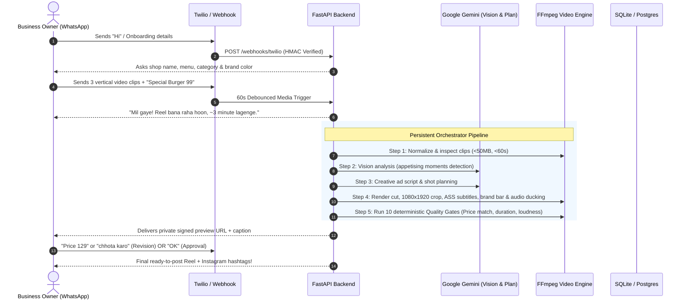

<div align="center">

# 🎬 Reelwala (CreatorOps)

**WhatsApp-first AI video ad engine for local food businesses.**  
*Turns 2–5 raw phone clips from a local street food stall or café into a high-converting, vertical (1080x1920) Reel preview with burned-in subtitles, hook text, offer badges, ducked music, and an Instagram-ready caption.*

[]()
[]()
[]()
[]()
[]()

</div>

---

## 📌 Architecture & Conversation Flow



---

## 🛠️ Prerequisites

- **Python**: 3.11+
- **FFmpeg & FFprobe**: Required on your system `PATH` (used for clip normalization, volume ducking, ASS subtitle burning, and quality gate validation).
  - *Windows*: Download from [gyan.dev](https://www.gyan.dev/ffmpeg/builds/) or run `winget install Gyan.FFmpeg`.
  - *Ubuntu/Debian*: `sudo apt-get install -y ffmpeg`
  - *macOS*: `brew install ffmpeg`

---

## 🚀 Quickstart & Setup

### 1. Clone the repository
```bash
git clone https://github.com/Omhari66/Reelwala.git
cd Reelwala
```

### 2. Create and activate a virtual environment
```bash
python -m venv .venv

# Windows PowerShell:
.venv\Scripts\Activate.ps1

# Linux / macOS:
source .venv/bin/activate
```

### 3. Install dependencies
```bash
pip install -r requirements.txt
```

### 4. Initialize database schema
```bash
alembic upgrade head
```

---

## ⚙️ Configuration (.env)

Copy `.env.example` to `.env` and fill in your values:

```bash
cp .env.example .env
```

| Variable | Description | Example / Default |
|---|---|---|
| `LLM_PROVIDER` | LLM client backend (`gemini` or `fake`) | `gemini` |
| `LLM_API_KEY` | Google Gemini API Key from Google AI Studio | `AIza...` |
| `LLM_MODEL_VISION` | Model identifier for vision analysis | `gemini-1.5-flash` |
| `LLM_MODEL_TEXT` | Model identifier for ad copywriting | `gemini-1.5-flash` |
| `DATABASE_URL` | SQLAlchemy connection string | `sqlite:///./dev.db` |
| `REDIS_URL` | Redis URL for RQ worker tasks | `redis://localhost:6379/0` |
| `STORAGE_BACKEND` | Media file storage backend (`local` or `s3`) | `local` |
| `STORAGE_PATH` | Local filesystem storage path | `./data` |
| `TWILIO_ACCOUNT_SID` | Twilio Account SID for WhatsApp messaging | `AC...` |
| `TWILIO_AUTH_TOKEN` | Twilio Auth Token (used for HMAC signature validation) | `...` |
| `TWILIO_WHATSAPP_FROM`| Twilio WhatsApp sender number | `whatsapp:+14155238886` |
| `PUBLIC_BASE_URL` | Public base URL used for signed video URLs | `https://xxxx.ngrok-free.app` |
| `ADMIN_TOKEN` | Secret token to access `/admin/jobs` dashboard | `change-me` |
| `MONTHLY_VIDEO_LIMIT` | Max completed Reels per business per month | `10` |
| `USD_INR` | Currency conversion rate for compute/token cost logging | `85.0` |
| `ENABLE_VOICE_NOTES` | Optional voice note transcription toggle | `false` |

---

## 📱 WhatsApp Sandbox Testing (Twilio + ngrok)

1. **Start the API server**:
   ```bash
   uvicorn app.main:app --port 8000 --reload
   ```

2. **Expose port 8000 using ngrok**:
   ```bash
   ngrok http 8000
   ```
   Copy your HTTPS URL (e.g. `https://xxxx.ngrok-free.app`) and set it as `PUBLIC_BASE_URL` in `.env`.

3. **Configure Twilio WhatsApp Sandbox**:
   - In the [Twilio Console](https://console.twilio.com/), go to **Messaging** $\rightarrow$ **Try it out** $\rightarrow$ **Send a WhatsApp message**.
   - Under **Sandbox Settings**, set **WHEN A MESSAGE COMES IN**:
     - **URL**: `https://xxxx.ngrok-free.app/webhooks/twilio`
     - **HTTP Method**: `POST`
   - Save your settings.

4. **Chat with your Bot**:
   - Send `join <your-code>` from WhatsApp to the Twilio number.
   - Send `"hi"` to onboard your shop, input your menu items, and send 3 vertical phone clips!

---

## 💻 Local CLI Execution (Without WhatsApp)

Generate a complete marketing Reel locally from CLI using `scripts/run_local.py`:

```bash
# 1. Generate synthetic vertical test clips (if needed):
python -m tests.make_fixtures

# 2. Run end-to-end local pipeline:
python -m scripts.run_local \
  --clips tests/fixtures/synthetic/clip1_sharp.mp4 tests/fixtures/synthetic/clip2_blurred.mp4 tests/fixtures/synthetic/clip3_dark.mp4 \
  --message "Special Tandoori Momo Rs 99 for college students" \
  --fake-llm
```

Generated outputs in `out/`:
- `out/preview.mp4`: Final vertical 1080x1920 Reel.
- `out/plan.json`: Creative plan and subtitle timestamps.
- `out/quality_report.json`: Deterministic 10-gate quality report.
- `out/cost.json`: Step timings, token usage, and INR compute cost.

---

## 🛡️ Reliability, Quality Gates & Safety

- **Deterministic Price Verification (Gate 6)**: The code enforces that every rupee figure in subtitles/hooks strictly matches an active menu item or owner text. The LLM is never trusted with price equality.
- **Persistent Orchestration**: Saves step outputs in `CampaignStep.output_json`, retries transient failures with exponential backoff, and resumes mid-step without re-rendering completed cuts.
- **Per-Business Concurrency Lock**: Prevents overlapping parallel render jobs for the same business.
- **Media Safety**: Rejects uploads $> 50\text{ MB}$ or $> 60\text{ s}$ with friendly Hindustani copy.
- **Privacy Wipeout Script**:
  ```bash
  python -m scripts.delete_business --phone "+919876543210" --force
  ```
- **Operator Admin Dashboard**:
  Access live jobs, durations, costs, and step errors at:
  ```
  http://localhost:8000/admin/jobs?token=change-me
  ```

---

## 🧪 Testing & Linting

Run all 77 automated unit and integration tests:
```bash
pytest -q
```

Run code formatting and linting:
```bash
ruff check .
```

---

## 📄 License

MIT License. Designed and built for local food businesses.
